# Danh mục 11 ảnh cá nhân A01–A11

Sinh viên Lương Minh Trực — N24DCDT100 — DT084.

SHA C dùng chạy và chụp kết quả: `ccaf13ab5c6bca2a9affc669f42508e7d0f6848a`. Mã/test/input giữ nguyên khi thêm bộ ảnh này.

Mỗi mục dưới có input hoặc vị trí input, lệnh chạy, expected/actual, chú thích và ít nhất hai câu phân tích. Giữ nguyên ảnh gốc; khi viết báo cáo cần chèn ảnh và nội dung tương ứng.

## A01 — Ví dụ 1 trên phiếu

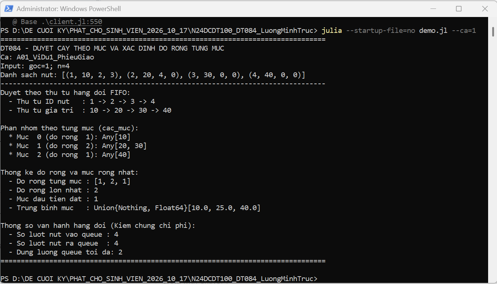

**Chú thích:** Hình 4.1. Ví dụ 1 trên phiếu.

**Lệnh/thao tác:** `julia --startup-file=no demo.jl --ca=1`

**Input/vị trí input:** goc=1; [(1,10,2,3),(2,20,4,0),(3,30,0,0),(4,40,0,0)]

**Expected và actual đối chiếu:** Các mức [[10],[20,30],[40]], độ rộng [1,2,1], rộng nhất 2, mức 1.

**Phân tích:** Hai nút 20 và 30 được xử lý trước nút 40 ở mức tiếp theo. Kết quả thực tế khớp kỳ vọng tính từ sơ đồ cây, đồng thời mỗi nút vào/ra queue đúng một lần.

## A02 — Ví dụ 2 trên phiếu

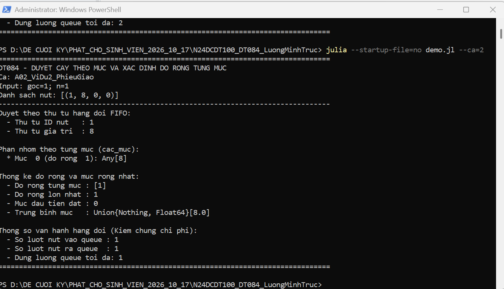

**Chú thích:** Hình 4.2. Ví dụ 2 trên phiếu.

**Lệnh/thao tác:** `julia --startup-file=no demo.jl --ca=2`

**Input/vị trí input:** goc=1; [(1,8,0,0)]

**Expected và actual đối chiếu:** Các mức [[8]], rộng nhất 1, mức 0.

**Phân tích:** Cây một nút có đúng một mức chứa gốc với giá trị 8. Thực tế trả rộng nhất 1 và mức 0, đúng quy ước đánh số mức bắt đầu từ không.

## A03 — Ca tự thiết kế: cây đầy 7 nút

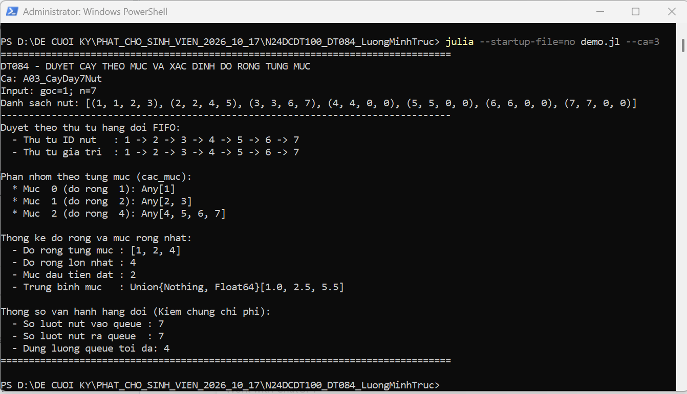

**Chú thích:** Hình 4.3. Ca tự thiết kế: cây đầy 7 nút.

**Lệnh/thao tác:** `julia --startup-file=no demo.jl --ca=3`

**Input/vị trí input:** goc=1; các ID 1..7; con của 1 là 2,3, của 2 là 4,5, của 3 là 6,7; input đầy đủ hiện trên ảnh

**Expected và actual đối chiếu:** Độ rộng [1,2,4], rộng nhất 4, mức 2.

**Phân tích:** Các nút được duyệt lần lượt từ trái sang phải trong từng mức. Bốn nút lá ở mức 2 tạo độ rộng lớn nhất, khớp kết quả dự kiến.

## A04 — Ca tự thiết kế: hòa độ rộng

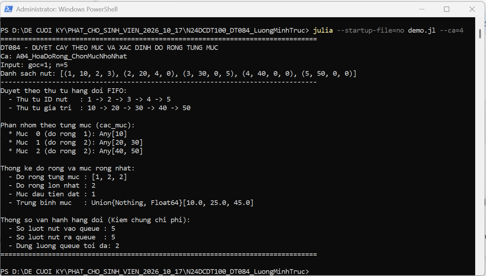

**Chú thích:** Hình 4.4. Ca tự thiết kế: hòa độ rộng.

**Lệnh/thao tác:** `julia --startup-file=no demo.jl --ca=4`

**Input/vị trí input:** goc=1; [(1,10,2,3),(2,20,4,0),(3,30,0,5),(4,40,0,0),(5,50,0,0)]

**Expected và actual đối chiếu:** Độ rộng [1,2,2], rộng nhất 2, chọn mức 1.

**Phân tích:** Mức 1 và mức 2 cùng có hai nút nên cùng đạt độ rộng lớn nhất. Chương trình giữ mức 1 là mức đầu tiên, đúng quy tắc xử lý hòa của phiếu.

## A05 — Ca biên: cây rỗng

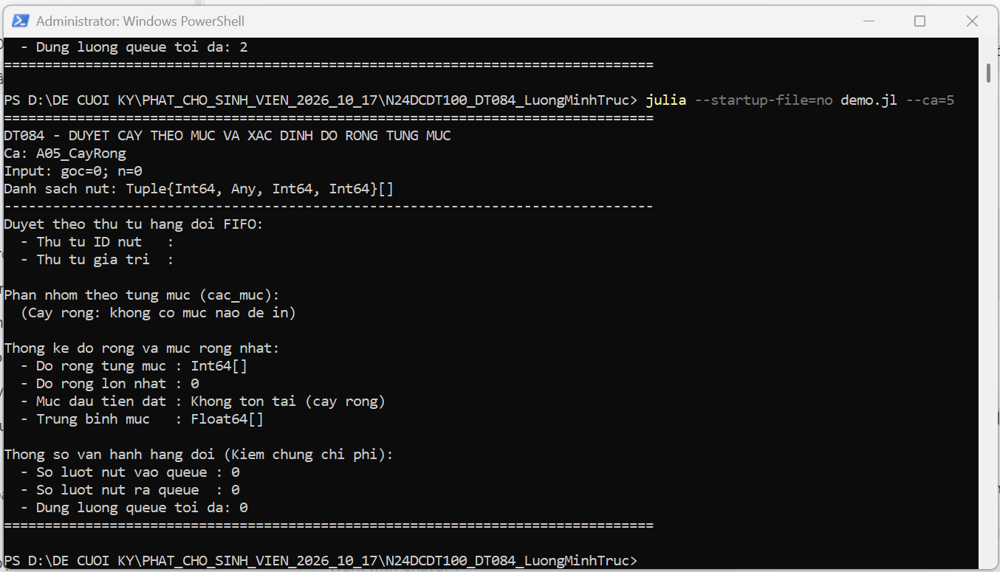

**Chú thích:** Hình 4.5. Ca biên: cây rỗng.

**Lệnh/thao tác:** `julia --startup-file=no demo.jl --ca=5`

**Input/vị trí input:** goc=0; danh sách nút rỗng

**Expected và actual đối chiếu:** Không có mức; rộng nhất 0; mức rộng nhất không tồn tại; số lượt queue bằng 0.

**Phân tích:** Cây rỗng không đưa gốc vào queue và không tạo nhóm mức giả. Kết quả rộng 0, không có mức rộng nhất, khớp kỳ vọng và không truy cập phần tử ngoài miền.

## A06 — Ca biên: dây phải 4 nút

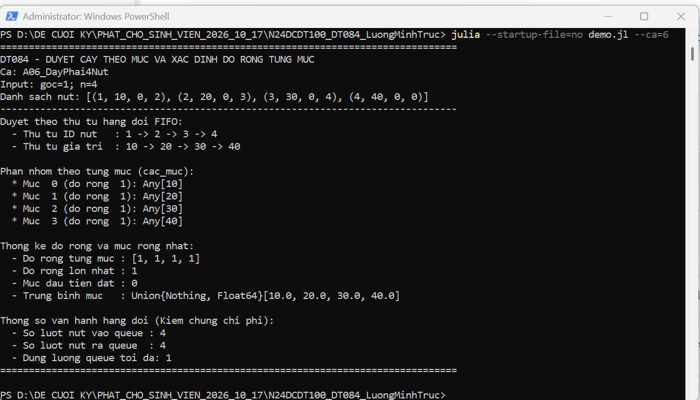

**Chú thích:** Hình 4.6. Ca biên: dây phải 4 nút.

**Lệnh/thao tác:** `julia --startup-file=no demo.jl --ca=6`

**Input/vị trí input:** goc=1; [(1,10,0,2),(2,20,0,3),(3,30,0,4),(4,40,0,0)]

**Expected và actual đối chiếu:** Độ rộng [1,1,1,1], rộng nhất 1, mức 0, queue chờ lớn nhất 1.

**Phân tích:** Mỗi mức chỉ có một nút nên bốn mức hòa độ rộng bằng một. Chương trình chọn mức 0 và đo tối đa một nút đang chờ, phù hợp dạng cây dây.

## A07 — Ca biên: gốc có hai lá

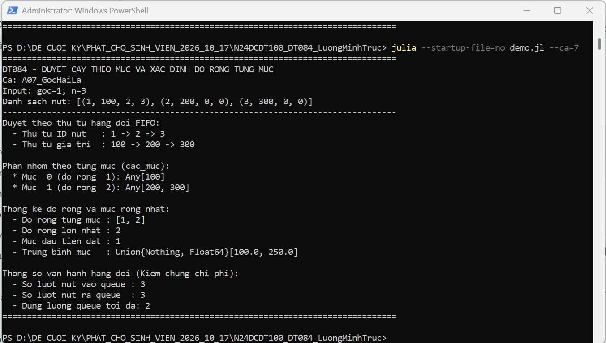

**Chú thích:** Hình 4.7. Ca biên: gốc có hai lá.

**Lệnh/thao tác:** `julia --startup-file=no demo.jl --ca=7`

**Input/vị trí input:** goc=1; [(1,100,2,3),(2,200,0,0),(3,300,0,0)]

**Expected và actual đối chiếu:** Các mức [[100],[200,300]], độ rộng [1,2], rộng nhất 2, mức 1.

**Phân tích:** Hai nút lá được xếp chung mức 1 và theo thứ tự trái trước phải. Thực tế trả độ rộng lớn nhất 2 tại mức 1, khớp sơ đồ cây.

## A08 — Input không hợp lệ

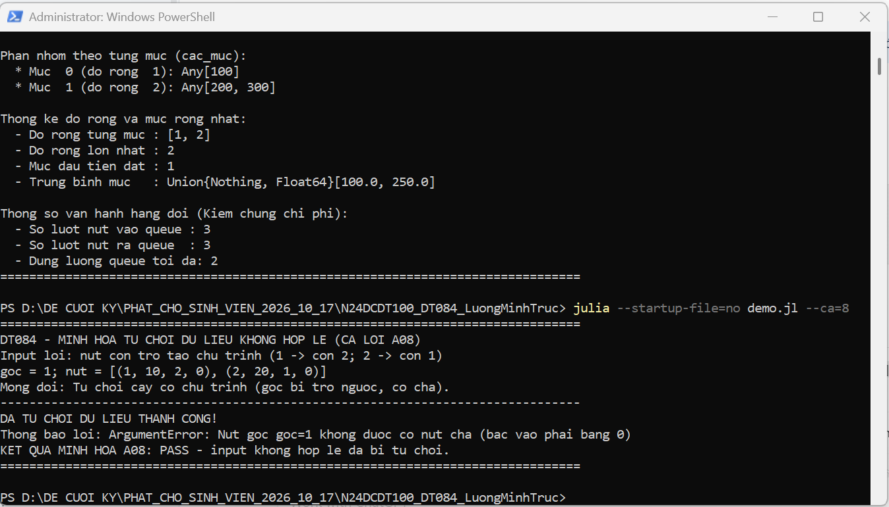

**Chú thích:** Hình 4.8. Input không hợp lệ.

**Lệnh/thao tác:** `julia --startup-file=no demo.jl --ca=8`

**Input/vị trí input:** goc=1; [(1,10,2,0),(2,20,1,0)]

**Expected và actual đối chiếu:** Từ chối bằng ArgumentError vì gốc có cha; demo báo đã từ chối đúng thiết kế.

**Phân tích:** Liên kết 1→2→1 tạo chu trình và làm gốc có cha, vi phạm hợp đồng cây. Validator phát hiện trước khi duyệt chính; PASS ở đây nghĩa là từ chối input sai đúng kỳ vọng, không phải chấp nhận cây đó.

## A09 — Tổng kết bộ kiểm thử

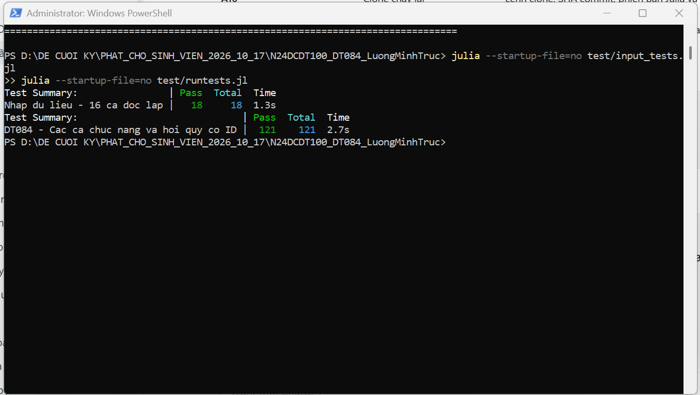

**Chú thích:** Hình 4.9. Tổng kết bộ kiểm thử.

**Lệnh/thao tác:** `julia --startup-file=no test/input_tests.jl; julia --startup-file=no test/runtests.jl`

**Input/vị trí input:** Input và expected nằm trong test/input_tests.jl (I01–I16) và test/runtests.jl (T01–T38)

**Expected và actual đối chiếu:** 18/18 phép kiểm nhập liệu và 121/121 phép kiểm thuật toán đạt.

**Phân tích:** Cả hai bộ kiểm thử kết thúc với số Pass bằng Total và không có lỗi kiểm thử. Số phép kiểm không đồng nghĩa số ca: bộ thuật toán có 38 nhóm ID, bộ nhập liệu có 16 nhóm ID; T11 chứa nhiều input validator.

## A10 — Kiểm phiên bản C và chạy lại từ clone

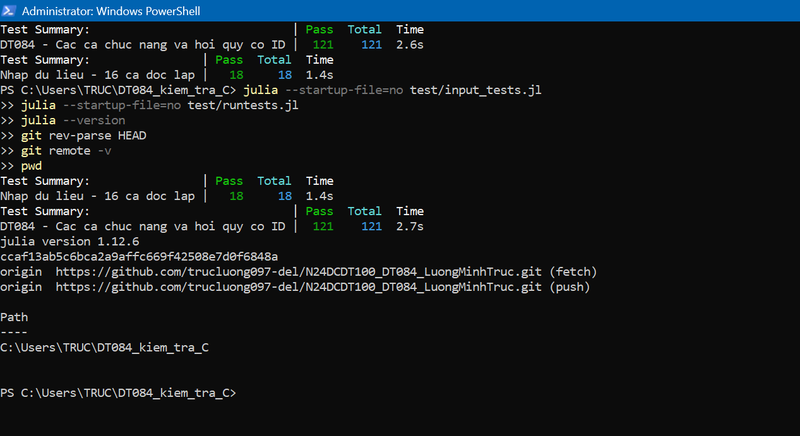

**Chú thích:** Hình 4.10. Kiểm phiên bản C và chạy lại từ clone.

**Lệnh/thao tác:** `Ảnh hiện pwd; git remote -v; git rev-parse HEAD; julia --version; hai lệnh test`

**Input/vị trí input:** Thư mục C:/Users/TRUC/DT084_kiem_tra_C; origin là repo trucluong097-del/N24DCDT100_DT084_LuongMinhTruc

**Expected và actual đối chiếu:** HEAD=ccaf13ab5c6bca2a9affc669f42508e7d0f6848a; Julia 1.12.6; test đạt 121/121 và 18/18.

**Phân tích:** Thư mục kiểm tra riêng, URL origin và SHA HEAD xác định đúng phiên bản mã được chạy lại. Hai bộ test vẫn đạt toàn bộ trên Julia 1.12.6; nhật ký clone_C.log cung cấp thêm kết quả chạy hai ví dụ và quy trình đầy đủ.

## A11 — Repo và commit GitHub thật

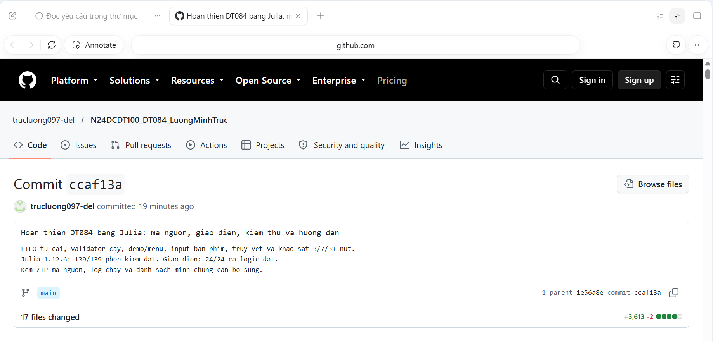

**Chú thích:** Hình 4.11. Repo và commit GitHub thật.

**Lệnh/thao tác:** `Mở trang commit C trên GitHub`

**Input/vị trí input:** https://github.com/trucluong097-del/N24DCDT100_DT084_LuongMinhTruc/commit/ccaf13ab5c6bca2a9affc669f42508e7d0f6848a

**Expected và actual đối chiếu:** Tài khoản trucluong097-del, repo đúng tên, commit ccaf13a và 17 tệp thay đổi.

**Phân tích:** Trang GitHub cho thấy commit C thật chứa bản Julia, bộ test, hướng dẫn và ZIP mã nguồn. SHA trên trang trùng SHA trong ảnh A10, giúp đối chiếu nguồn tạo kết quả với phiên bản đã công bố.

## Kiểm tra trước khi nộp

Ảnh A10 ghi bước kiểm phiên bản và test trong thư mục clone; nhật ký clone_C.log bổ sung quy trình chạy hai ví dụ và toàn bộ bộ test từ C. Sau khi chốt S vẫn cần clone S và chạy lại; SHA S và xác nhận kết quả ghi vào TXT nộp rời. Báo cáo Word/PDF và TXT chưa được tạo trong lần cập nhật ảnh này.
